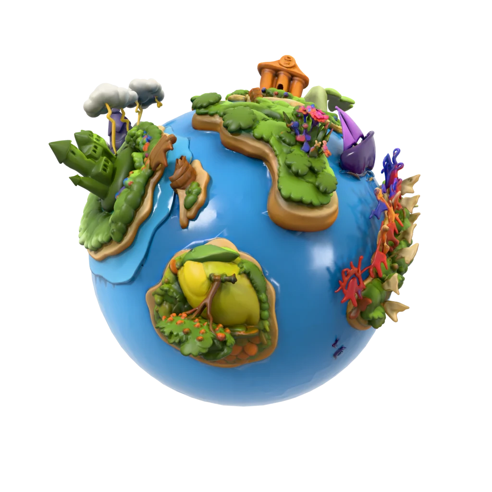
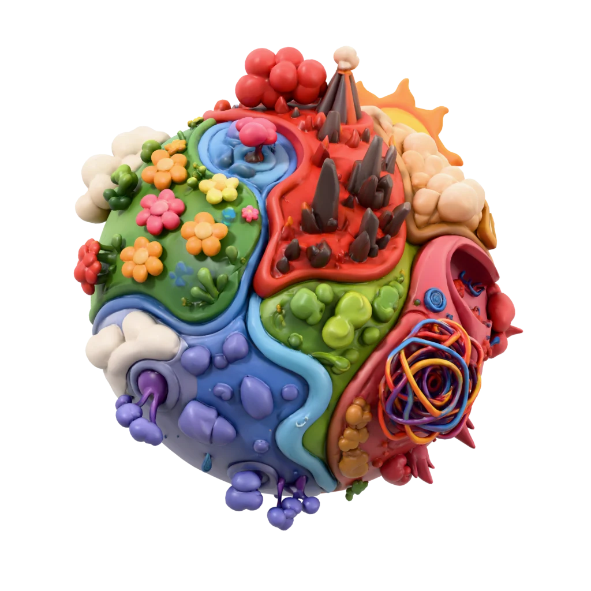
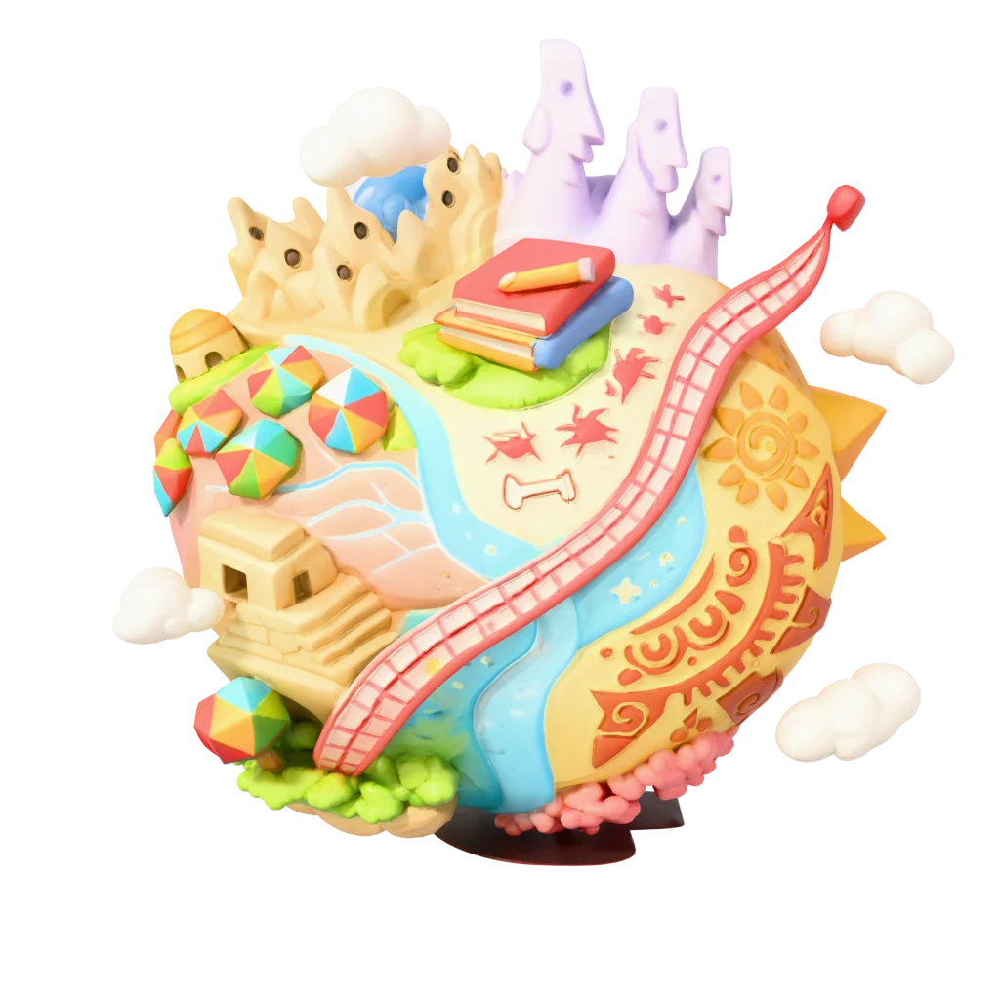
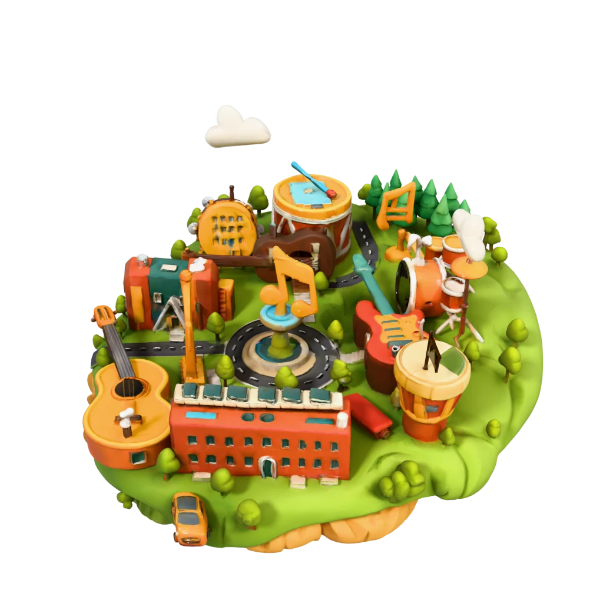
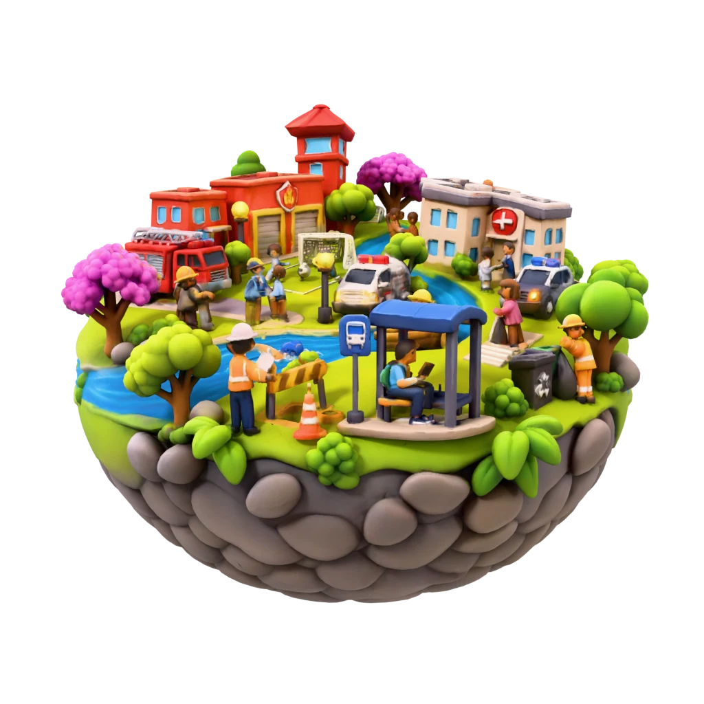
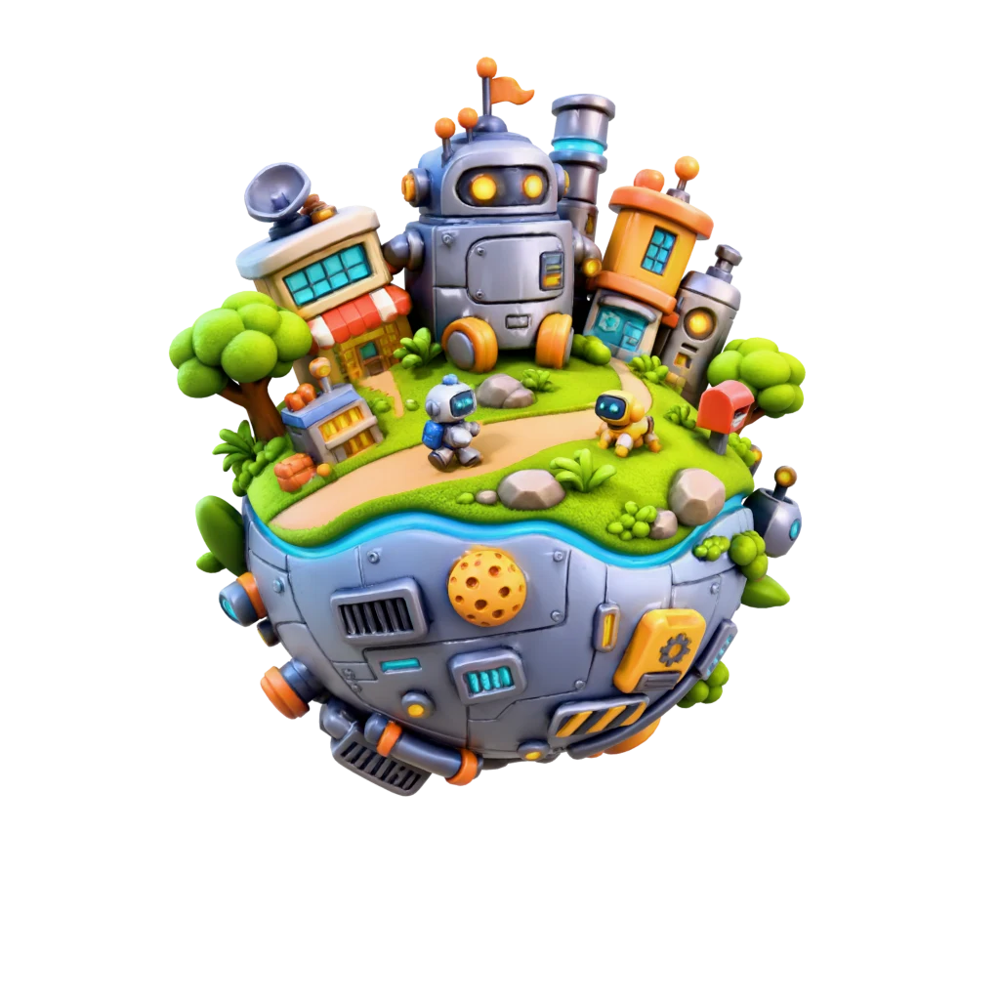

# Planetas 3D · Exploradores

Os planetas de massinha dos Exploradores (Jovens Gênios) em 3D, girando no eixo vertical: uma volta a cada 40 s, com giro pela mão, pelo teclado e pelo toque. Cada planeta tem **menos de 1 MB**.

O componente desenha **só o planeta girando**, com fundo transparente. O fundo, o seletor, os botões e a aba de código da vitrine são demonstração e não fazem parte do kit.

| | |
| --- | --- |
| **Vitrine** | https://planetas-3d.vercel.app |
| **Kit para a engenharia (.zip)** | https://github.com/Jovens-Genios/Planetas-3D/releases/download/kit-planetas/kit-planetas.zip |
| **Guia em PDF** | https://github.com/Jovens-Genios/Planetas-3D/releases/download/kit-planetas/GUIA-ENGENHARIA.pdf |
| **Catálogo ao vivo** | https://planetas-3d.vercel.app/planetas/catalogo.json |
| **Produção (S3)** | [Hospedar na S3](#produção-na-s3) |

## Para a engenharia: instalar uma vez e usar pelo id

```bash
# 1. baixe e descompacte na raiz do projeto Next.js: cria components/planetas/
REPO=https://github.com/Jovens-Genios/Planetas-3D
curl -LO $REPO/releases/download/kit-planetas/kit-planetas.zip
unzip -o kit-planetas.zip -x LEIA-ME.txt && rm kit-planetas.zip

# 2. instale o three.js
npm i three
npm i -D @types/three
```

```tsx
// 3. use onde o planeta aparece (funciona em Server Components)
import { Planeta } from '@/components/planetas'

<Planeta id="planeta-emocoes" tamanho={240} alt="Planeta Emoções" />
```

- **Arquivos:** o .zip traz só o componente. Os modelos e os pôsteres vêm deste site (`https://planetas-3d.vercel.app/`, para testes) ou, em produção, da S3 indicada em `NEXT_PUBLIC_PLANETAS_URL` ([Produção na S3](#produção-na-s3)).
- **Planeta novo:** é só usar o id novo, sem baixar nada.
- **Se o projeto usa `src/`:** mova a pasta para `src/components/planetas`.

## Produção na S3

O site da Vercel serve para testes. Em produção, os arquivos ficam na S3 da Jovens Gênios, com uma CDN na frente. A configuração é feita uma vez; o componente e o uso pelo id não mudam.

1. **Bucket e CDN:** bucket privado com CloudFront (acesso por OAC), política de cache **CachingOptimized** e de cabeçalhos de resposta **SimpleCORS**. Servindo direto da S3, aplique [`ferramentas/s3/cors.json`](ferramentas/s3/cors.json):
   ```bash
   aws s3api put-bucket-cors --bucket <bucket> --cors-configuration file://ferramentas/s3/cors.json
   ```
2. **Primeira carga** (AWS CLI configurado). Copia `public/planetas/` e `public/draco/` com o tipo e o cache certos e envia o catálogo por último. `SECO=1` só mostra o que faria.
   ```bash
   BUCKET=<bucket> PREFIXO=exploradores CLOUDFRONT_ID=<id> bash ferramentas/s3/publicar_s3.sh
   ```
3. **Conferir** todos os arquivos pelo endereço público (200, tipo, CORS, tamanho):
   ```bash
   node ferramentas/s3/verificar.mjs https://<cdn>/exploradores/
   ```
4. **Apontar os projetos:** `NEXT_PUBLIC_PLANETAS_URL=https://<cdn>/exploradores/` no `.env` ou nas variáveis do deploy (lida no build). Libere a CDN na CSP (`img-src`, `connect-src`) e inclua `'wasm-unsafe-eval'` em `script-src`.
5. **Planeta novo automático:** o workflow [`.github/workflows/publicar-s3.yml`](.github/workflows/publicar-s3.yml) roda o passo 2 a cada push na `main` que mexa nos planetas. Fica desligado até preencher, em *Settings → Secrets and variables → Actions*:
   - variáveis `S3_BUCKET` e `AWS_REGION` (obrigatórias), `S3_PREFIXO`, `CLOUDFRONT_ID`, `PLANETAS_URL` (conferência no fim) e `AWS_ROLE_ARN` (OIDC, recomendado);
   - ou os secrets `AWS_ACCESS_KEY_ID` e `AWS_SECRET_ACCESS_KEY`;
   - permissões: `s3:ListBucket`, `s3:PutObject` e `cloudfront:CreateInvalidation`.

| Arquivo | Content-Type | Cache-Control |
| --- | --- | --- |
| `planetas/catalogo.json` | `application/json` | 5 min |
| `planetas/<id>/planeta.glb` | `model/gltf-binary` | 5 min (planeta atualizado mantém o nome) |
| `planetas/<id>/poster.webp` | `image/webp` | 5 min |
| `draco/*.wasm`, `draco/*.js` | `application/wasm`, `text/javascript` | 1 ano, `immutable` |

O script não apaga nada no bucket. O passo a passo também está nas páginas 6 e 7 do guia.

Props, perguntas frequentes e CSP estão no [guia em PDF](https://github.com/Jovens-Genios/Planetas-3D/releases/download/kit-planetas/GUIA-ENGENHARIA.pdf).

## Planetas

<!-- planetas:inicio (tabela gerada por ferramentas/adicionar_planeta.py) -->
| | Planeta | id |
| --- | --- | --- |
|  | Mitologia | `planeta-mitologia` |
|  | Empreendedorismo | `planeta-empreendedorismo` |
|  | Emoções | `planeta-emocoes` |
|  | Artes | `planeta-artes` |
|  | Computação | `planeta-computacao` |
|  | Fantasia | `planeta-fantasia` |
|  | Música | `planeta-musica` |
|  | Terra | `planeta-terra` |
|  | Alfabetização | `planeta-alfabetizacao` |
|  | Trânsito | `planeta-transito` |
|  | Esportes | `planeta-esportes` |
|  | Profissões | `planeta-profissoes` |
|  | Robótica | `planeta-robotica` |
|  | Educação Financeira | `planeta-educacao-financeira` |
<!-- planetas:fim -->

O id é sempre `planeta-<nome>`, sem acentos. No código, `await carregarPlanetas()` devolve a lista com `id` e `nome`.

## Adicionar um planeta

1. **Otimizar** o `.glb` do planeta no Blender 5.3. O script reduz de ~65 MB para ~2,5 MB, centraliza a esfera e gera o pôster:

   ```bash
   blender -b --factory-startup -P ferramentas/otimizar_glb.py -- \
     --entrada esportes.glb --saida saida/planeta-esportes \
     --id planeta-esportes --nome "Esportes" --inicio 0
   ```

   - `--inicio` é o ângulo em que o planeta aparece primeiro (o mesmo do pôster).
   - `--elevacao` é a altura da câmera, em graus (padrão 12).
   - `--forma ilha` e `--rosto x,y,z` são para modelos fora do padrão.
2. **Registrar:** `python3 ferramentas/adicionar_planeta.py "<pasta de saída>"` (precisa de `npm install`).
   - Comprime o planeta para **menos de 1 MB** com `ferramentas/comprimir_glb.mjs`: malha Draco, ~60% dos triângulos onde a forma não muda e cor 2K em AVIF, sem perda visível.
   - Atualiza o catálogo e refaz a tabela acima, o LEIA-ME do kit e o PDF.
3. **Publicar:**
   1. commit e push;
   2. deploy na Vercel (site de testes); com o envio automático configurado, o push também leva o planeta para a S3;
   3. `bash ferramentas/publicar_kit.sh`, que atualiza o .zip e o PDF da release.

## Estrutura

| Caminho | O que é |
| --- | --- |
| `components/planetas/` | O componente que vai no kit: `<Planeta id>`, `PlanetaGirando` (three.js), catálogo remoto |
| `public/planetas/` | `catalogo.json` (fonte única) e `<id>/planeta.glb` (< 1 MB) + `poster.webp` de cada planeta |
| `public/draco/` | Decodificador da malha (Draco), baixado uma vez pelo navegador |
| `vitrine/`, `app/` | A vitrine (Next.js): seletor de planeta, tamanhos e aba de código para a engenharia |
| `ferramentas/` | Otimizador (Blender), compressão (`comprimir_glb.mjs`), `adicionar_planeta.py`, gerador do guia em PDF e publicação do kit |
| `GUIA-ENGENHARIA.pdf` | O guia, gerado a partir do catálogo |
| `ferramentas/s3/` | Produção: `publicar_s3.sh` (envio), `verificar.mjs` (conferência) e `cors.json` |
| `.github/workflows/publicar-s3.yml` | Envio automático para a S3 a cada planeta novo |
| `vercel.json` | CORS em `/planetas/*` e `/draco/*` (site de testes) |

## Rodar localmente

```bash
npm install
npm run dev   # http://localhost:3000 · ?screen=planeta-esportes abre direto num planeta
```

Stack: Next.js 15, React 19, three 0.170 e lucide-react.

## Comportamento

- **Giro:** uma velocidade só.
- **Mão:** arrastar gira, com embalo ao soltar; no celular, deslizar na vertical rola a página.
- **Teclado:** setas ← e →.
- **"Reduzir movimento":** o planeta não gira sozinho, mas a mão continua funcionando.
- **Carregamento:** o pôster aparece na hora, e o 3D (menos de 1 MB) só carrega quando o planeta está na tela.
- **Sem WebGL ou sem rede:** fica o pôster.
- **Desempenho:** para de desenhar fora da tela e baixa a resolução sozinho em aparelho lento.
